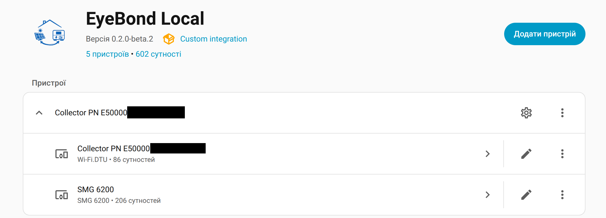

# EyeBond Local for Home Assistant

Local monitoring and supported controls for solar inverters with **EyeBond-compatible Wi-Fi collectors**, including devices used with **SmartESS, SmartValue and DESSMonitor**.

[Українська](README.uk.md) · [Documentation](https://groove-max.github.io/ha-eybond-local/en/) · [Compatibility](docs/user/COMPATIBILITY.md) · [Get help](docs/user/SUPPORT_ARCHIVE.md)

> HACS must already be installed. This is a **custom repository**, not a built-in Home Assistant integration. Manual installation is also available.

## Is this integration for my inverter?

Start with the **collector and protocol**, not just the inverter brand. Models sold as Anenji, PowMr, Sandisolar, MUST, Victor, Kevolt and others have different levels of support. An app name or a shared firmware identifier does not guarantee compatibility.

[Check compatibility](docs/user/COMPATIBILITY.md) and the [model-by-model evidence](docs/generated/INVERTER_MODEL_CATALOG.generated.md). An unlisted model may work through a supported protocol; unsupported hardware needs a Support Archive before we can confirm it.

## What it does

- Reads PV, battery, load, grid, energy and operating-status data over your network.
- Exposes confirmed local controls; available settings depend on model, firmware and control mode.
- Discovers collectors locally or connects through explicitly configured routed networks.
- Offers **Cloud + Home Assistant** and **Home Assistant only** on compatible collectors.
- Helps investigate missing settings with **Shadow Learning / Write Controls**, where supported.
- Provides collector diagnostics, Support Archives and developer-directed traffic capture.
- Works with the optional [EyeBond Local Card](https://github.com/groove-max/ha-eybond-local-card).

Normal local readings do not require a cloud login. Keeping Cloud + Home Assistant enabled still lets the collector communicate with the vendor cloud. Learning and cloud evidence are separate, optional features.

## Installation

**Choose a channel before downloading.** The current published 0.3 beta is **0.3.0-beta.5**; GitHub's “Latest release” link currently points to the older stable **0.1.53**. Newer fixes on `main` are not automatically part of beta.5. [Release channels and safe updates →](docs/user/INSTALLATION.md)

1. Add this repository to **HACS → Custom repositories**, category **Integration**.
2. Download the intended published version. For a beta, enable prerelease versions in the download/version dialog if needed.
3. Restart Home Assistant.
4. Open **Settings → Devices & Services → Add Integration → EyeBond Local**.

[Manual installation and rollback](docs/user/INSTALLATION.md) are available without HACS.

### Testing the unreleased main branch

Only use a test build when you deliberately want unreleased changes, normally at a maintainer's request. Back up first, replace the complete integration directory and restart HA. Do not mix versions or leave backup copies inside `custom_components`. [Full test-build instructions](docs/user/INSTALLATION.md#testing-main).

Cloud Bridge 0.4 is separate development work, **not a feature of the published 0.3 beta or current 0.3 main build**.

## Setup

1. Connect the collector to Wi-Fi/LAN where Home Assistant can reach it.
2. Select the correct HA interface and scan.
3. Add the identified collector; inverter detection runs afterward.
4. Check live readings before changing settings.

For routed networks, add known collector IPs to the scan or use manual setup with the correct advertised callback address. Broadcast does not normally cross routers. [First connection](docs/user/GETTING_STARTED.md) · [Detailed setup](docs/user/SETUP_AND_DISCOVERY.md) · [Remote / NAT setup](docs/user/REMOTE_SETUP.md).

## After setup

Expect separate **collector** and **inverter** devices. Start with **Auto** control mode; **Read-only** disables writes, while **Full Control** can expose untested settings and does not prove that they work on your device.

Use automatic polling initially. See [sensors, controls and unavailable entities](docs/user/RUNTIME_AND_INVERTER.md).

## Device learning

Missing a setting that exists in the cloud app? **Write Controls** can identify cloud commands and add locally confirmed controls when the workflow supports your device. It does not guarantee every setting or the full range of values.

Read-only analysis collects evidence; it does **not** automatically add controls. Active learning can interrupt cloud access and retain a protection hold after an uncertain command. Read the [learning guide and recovery precautions](docs/user/LEARNING.md) before starting.

## Troubleshooting

[Connection, cloud and sensor troubleshooting](docs/user/TROUBLESHOOTING.md) covers common symptoms without resetting the device.

### Known cloud telemetry issue

On some installations, vendor-cloud updates pause while HA readings continue. The cause and a general fix remain unconfirmed. This differs from intentional HA-only mode or a learning protection hold. Capture diagnostics during the outage before restarting, when practical. [What to check and report](docs/user/TROUBLESHOOTING.md#cloud-updates-stop).

## Getting help

Create a **Support Archive** from **Configure → Diagnostics and service tools**, then [open an issue](https://github.com/groove-max/ha-eybond-local/issues). Include your version/channel, model, firmware if known, symptom and time zone. Review attachments before posting; do not share account passwords.

[Support Archive guide](docs/user/SUPPORT_ARCHIVE.md)

## Companion projects

- [EyeBond Local Card](https://github.com/groove-max/ha-eybond-local-card) — an optional dashboard, not required for the integration.
- [ESP EyeBond Collector](https://github.com/groove-max/esp-eybond-collector) — community collector firmware for supported wired inverters. It does not supply vendor-cloud features.

## Documentation

[Online documentation](https://groove-max.github.io/ha-eybond-local/en/) · [All repository guides](docs/README.md) · [Contributing](CONTRIBUTING.md)

The guides describe current 0.3 development behavior; some fixes are newer than the last published beta. Check the installation channel before following instructions for a new feature.

## License

[MPL-2.0](LICENSE). Community project; not affiliated with EyeBond, the cloud apps or inverter manufacturers.
