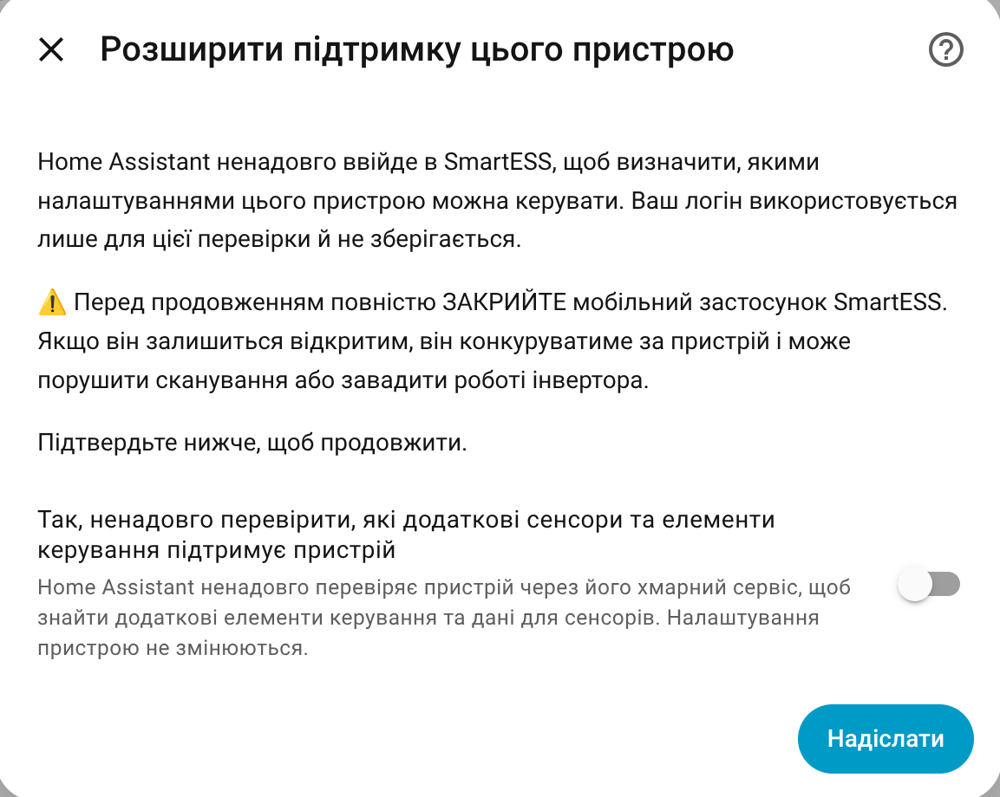
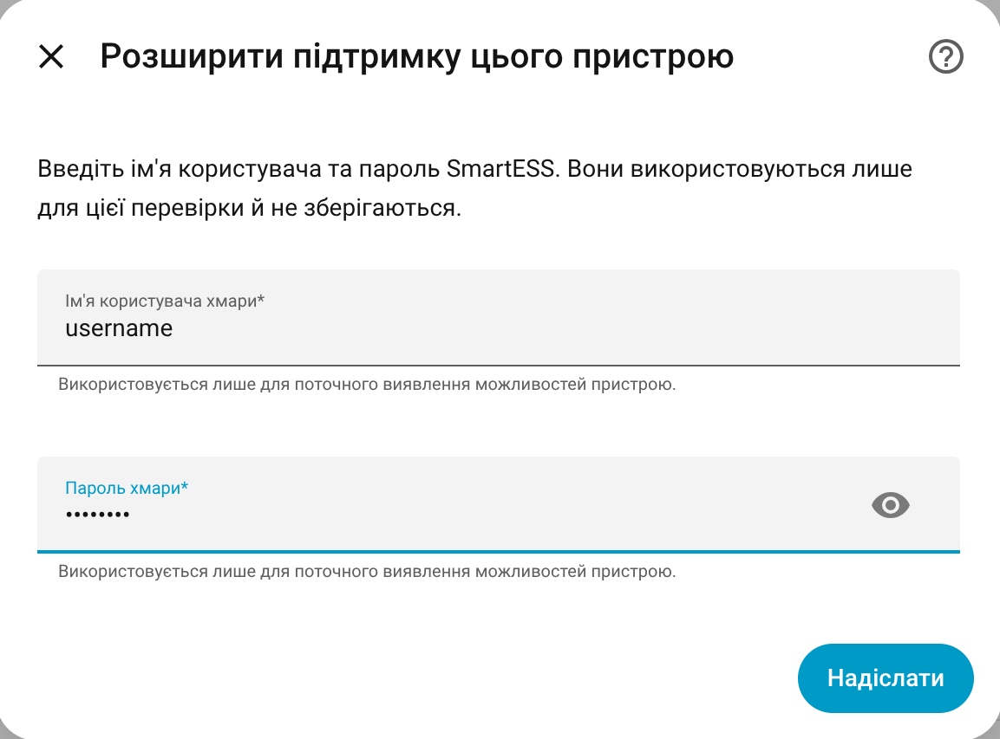
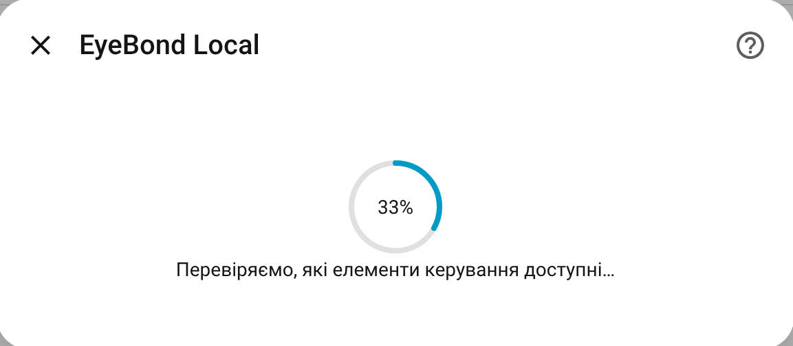

# Device Learning

Device learning is an advanced support flow for inverters that work in Home Assistant, but do not yet have full built-in support.

Most users do not need to run it. Use it when the integration offers it for your device, or when a developer asks for it while adding support for your model.

## What it can help with

Device learning can use more than one information source for your exact
inverter. The flow explains what each available source can do before asking for
credentials. Depending on the selected source, it can find:

- additional read-only sensors;
- selectable settings;
- numeric settings;
- switches;
- simple button-like actions.

Active learning shows locally proven items and lets you choose what to enable. A
read-only metadata check shows information that can help add support later, but
does not create entities until a local register mapping is proven.

Choose the task by the result you need:

| Task | What it does | Can change the device? |
|---|---|---:|
| **Analyze device data** | Collects cloud metadata and available history for support and comparison with local readings. | No |
| **Verify additional local controls** | Temporarily checks whether cloud fields can be matched safely to local reads or controls. | Only inside the protected verification described on screen |

Choose **Analyze device data** when investigating readings or collecting support
information. If the goal is a missing setting that already exists in the cloud
app, use **Verify additional local controls** when it is available and you can
accept its connection-change and interception precautions. You do not need to
run read-only analysis first: active verification collects its own metadata.

SmartESS and DESSMonitor active verification reuse a secure cloud connection
within one run. This reduces repeated connections but cannot prevent every cloud
timeout. If a test command's result is uncertain, the run stops without sending
that command again automatically. Cancelling can take a little time because HA
waits for an already started request to finish before connection cleanup.

## If preparation reports insufficient memory

Active learning currently requires at least 400 MiB of available RAM reported
by Linux `MemAvailable`. This is conservative admission headroom, not a claim
that learning itself allocates 400 MiB. A memory-blocked attempt sends no test
controls; it does not establish a cloud-protocol mismatch or remove any previous
protection hold. The result shows the measured availability and the threshold;
the Support Archive preserves the same numeric reason.

Free memory by stopping nonessential workloads, or increase the host/VM memory
allocation, before retrying. Changing the inverter profile or repeating the same
run without changing memory availability will not resolve this blocker. Keep the
existing connection settings and check the connection/protection status shown
by the wizard. Do not delete recovery files to bypass it.

## When cloud and local profiles use different protocols

Some inverters support several protocols. During framed EyeBond preparation,
the integration inspects cloud reads independently of the current driver.
If the protocol, route or learning readiness cannot be confirmed, it stops
before sending test controls and reports the problem.
Once the previous collector connection is restored, the result can offer
**Check cloud protocol compatibility (read-only)**. Candidates come from the
drivers' declared wire capabilities, not a fixed list of models. This checks
supported maps on the observed cloud address without changing the endpoint,
UART or current profile.
This includes **SmartESS 0925**. Where its catalog requires a separate tunnel
address for the identity check, only that specific read is allowed; the inverter
unit address is unchanged. A cloud device code alone does not select a profile.

During learning, a split-route driver can also use the additional tunnel
addresses it successfully read while collecting that run's seed. This covers
0925's separate data and configuration routes without treating address 255 as
a universal alias. The driver, device code and inverter unit must still match;
unproven routes stop preparation before test controls are sent.

A reply to one register request is not enough: the check must identify a supported
profile and obtain comparable live readings. Compare the displayed values with
your inverter before explicitly choosing the candidate profile. The default is
**Keep current profile**. Switching reloads the integration and repeats identification;
available entities may change. It does not automatically run learning or change
the control mode. Check the new readings, then start **Write Controls** again
only if the selected profile supports learning. Reading telemetry does not
prove write support; profiles without learning support are labelled accordingly.

If no compatible profile is confirmed, keep your current profile and share a Support Archive.
Do not select an arbitrary map. You can also return to the previous driver through the
runtime driver setting. A pending connection restoration or learning protection
must be resolved before this switch is offered.

The recognizer covers Modbus RTU, native PI30, PI18, G-ASCII, addressed
short-ASCII and 09C1 read grammars. A command shared by several dialects remains
ambiguous; it never automatically selects a driver. Unknown data does not invent
a map. The archive includes bounded validated read samples, route coordinates,
candidate-check results and structural diagnostics (length/digest for unknown
payloads, rather than arbitrary text that could contain credentials).

An observed raw command without a verified tunnel route is diagnostic evidence,
not permission to reuse or guess another route. The common profile mechanism
does not introduce new physical transports or translate commands between codecs.

## When to use it

Use device learning when:

- monitoring works, but controls are missing;
- the model is shown as partially supported;
- the collector is identified, but runtime has not yet found a supported
  inverter driver and you want to collect read-only evidence for support;
- the device was added as read-only, but the integration offers learning;
- a developer asks you to run it and share the result.

Do not use it just to “see what happens” on a fully supported inverter. If the device already has confirmed support, learning usually adds no value.

Read-only analysis may be available before the inverter is identified. It can
collect identity-bound cloud evidence, but it cannot invent a local driver or a
register mapping. Also check the inverter cable/UART connection and create a
Support Archive if runtime detection still does not complete.

## Before you start

Check these first:

- The collector has stable Wi-Fi.
- For active learning, the collector uses the **Cloud + Home Assistant**
  connection profile, or an eligible protected retry offered by the wizard.
  After the first test command, restoration requires verified completion of
  every sent command. If that cannot be confirmed, the collector stays on the
  verified local Home Assistant endpoint even when learning finds controls.
  Cloud telemetry and app control then remain disconnected pending reviewed
  recovery; accept this possible outage before starting. A read-only metadata
  source does not change the endpoint.
- For active verification, Home Assistant can read live data from the inverter.
- You know the cloud/app username and password for this device, if the learning
  flow asks for them.
- The mobile app for the same cloud account is closed while learning runs.
- You are near the inverter or can safely check it afterward.

If the inverter powers critical loads, run learning only when it is safe to recover manually.

## How to start

1. Open **Settings → Devices & Services**.
2. Open **EyeBond Local**.
3. Click **Configure**.
4. Choose **Expand device support**.
5. Open **Analyze cloud data and device capabilities**.
6. Choose **Analyze device data** for a read-only check, or **Verify additional
   local controls** only for an advanced active check.
7. If more than one compatible API is offered, choose the exact cloud source.
8. For active verification, read and accept both notices covering the local
   endpoint change, bounded cloud test commands, local interception, and the
   possible cloud outage that can remain after learning.
9. Enter the supported cloud/app credentials for this one session, if the flow
   asks for them.
10. Wait for the check to finish. Progress can pause while the selected cloud
    service waits for its next sample or history page; it must never move
    backwards.
11. Review the result. Only active learning can offer locally proven items to
    apply; read-only metadata remains support evidence.

The cloud/app password is not saved.

### Example: SmartESS active verification

The screens below were captured from the SmartESS active-verification path in
an earlier beta. They still illustrate the consent, temporary credential, and
progress stages. Current versions first ask you to choose the learning task and
cloud API, so the exact wording and the screens immediately before these may
differ. Follow the current on-screen text when it differs from an image.

## What happens during learning

Home Assistant first asks what you want to do. Read-only analysis collects
diagnostics; control verification is the separate advanced task for adding
missing cloud controls. If more
than one API can perform the selected task, the next step asks which API to use.
Choosing an API never silently changes the task.

For control verification:

Connection preparation waits for an in-flight local poll to finish and prevents
new polls from interrupting the checks, route change or startup recovery. This
applies to active verification, not ordinary read-only cloud analysis.

1. Home Assistant signs in to the selected cloud API with the credentials you entered.
2. It verifies the exact device identity and asks which settings and fields the cloud knows for this
   device.
3. Only after that succeeds, it changes the collector's endpoint to the normal
   local Home Assistant listener. It verifies a controlled reconnect without a
   UDP callback, the exact collector identity, endpoint readback and fresh local
   inverter data. If that cannot be verified, no cloud test commands are sent.
4. Before the first test command, Home Assistant durably records both the
   command intent and a cloud protection hold. The selected cloud API then sends
   bounded test commands for this exact device through the temporary filter.
5. Home Assistant captures the matching local write commands and blocks them
   before they reach the real inverter. If a cloud success cannot be matched to
   a local interception, the run stops as a possible unproxied write.
6. Home Assistant restores the original endpoint automatically only when every
   sent command has a verified completion receipt from the cloud API and the
   intercepted exchange. Otherwise it **keeps the collector local**, including after a scan
   that successfully found controls. Removing the temporary filter then returns
   the connection to normal local polling, not direct cloud access.
7. It builds a local result for review.

This endpoint transaction is the critical part of active verification. The
confirmation checkboxes cover rerouting, bounded cloud test commands and their
local interception, plus the possible continuing cloud outage. When completion
cannot be verified, cloud telemetry and app control remain unavailable pending
review with the maintainer. A timeout, restart or force-clear does not bypass
this protection. Local
HA telemetry and supported controls remain available, and successfully learned
controls can still be reviewed and applied. Read-only analysis does none of
these operations and never changes the collector endpoint.

The currently implemented method/source combinations are:

| Cloud source | Read-only analysis | Active verification |
|---|---:|---:|
| SmartESS API | Yes | Yes |
| DESSMonitor API | Yes | Yes |
| SmartClient / ShineMonitor | Yes | No |
| ValueCloud API | No | Yes |

API support alone does not guarantee that active learning is available for a
particular inverter. The local capture must also provide the data needed to
answer the cloud's protocol requests. For identified PI30 devices on a framed
EyeBond cloud connection, preparation can use real local PI30 query responses.
Inside the protected route it waits for a CRC-valid cloud read addressed to
that same inverter, after verifying the collector identity on the new socket.
Only a matching query with a captured answer enables test controls. Heartbeats,
cloud login, a model name, and unverified write commands do not enable them.
Each reconnect requires fresh protocol confirmation.

If the cloud actually requests Modbus registers, PI30 ASCII responses cannot
supply the missing register data. Preparation stops before test controls and
explains the mismatch. A timeout without a matching read is reported separately.
Download a Support Archive and check the displayed restoration/protection status;
neither error is proof of cloud restoration. Other unsupported paths can still
report `missing_register_seed`. Repeating the same capture or switching to
read-only analysis does not resolve a protocol mismatch.

Learned native PI30 controls preserve exact command case and padding. Numeric
controls require consistent command/value samples and use cloud limits when
provided; observed test values are not invented limits. Drafts remain scoped to
the device and untested. A synthetic learning ACK is not physical write/readback
confirmation. This preparation path does not yet implement native PI30 learning
inside a persistent Cloud Bridge session.

After activation, learned PI30 settings with a known QFLAG/QPIRI readback are
updated from fresh inverter replies, including changes made outside HA. Cloud
option numbers and labels are matched through the captured commands, not assumed
to equal the inverter's codes. A real write requires fresh readback; an ACK alone
does not confirm it. Unknown commands or values not represented by the learned
choices cannot provide a confirmed current setting. A failed confirmation is
not permission to repeat the write automatically: first check the actual setting.

For active verification, the options flow shows only sources compatible with
the cloud family already confirmed for this collector. Before a provider is
confirmed, read-only analysis can still offer registered metadata APIs for the
user to choose explicitly. SmartESS and DESSMonitor remain separate API choices
even when the same credentials work with both. Home Assistant uses only the
source selected for that run; it does not silently retry through another
service.

If you use **SmartClient** or **ShineMonitor**, select that exact source under
**Analyze device data**. Use the account that owns this collector. Home Assistant
downloads the readings, setting descriptions and available history. It also
records the size, timestamp and fingerprint of the latest raw cloud packet,
but not its contents: an unknown binary layout cannot be reliably anonymized.
An unavailable optional API does not discard the other
results. This is a support-data collection step, not an automatic inverter driver:
setting names and cloud field IDs alone do not prove local register addresses.
Save the Support Archive after the check so the maintainer can review the data.
SmartClient active control verification is not available yet.

You can finish this analysis even if Home Assistant has identified only the
collector, not the inverter. Cloud readings and setting descriptions are kept
for support; comparison with existing local sensors is skipped until a local
driver is available. A failed check also records its source and workflow stage
in the Support Archive, without saving your cloud password.

The goal is to learn what the device supports without permanently changing inverter settings.

### Numeric settings

For supported Modbus and native PI30 numeric commands, active verification captures
distinct test values to check how the displayed number is encoded. These commands are
intercepted, not applied to the inverter. A test value is not a recommended
setting or evidence of the inverter's permitted operating range.

Long numeric choice lists are sampled at up to three values actually offered by
the cloud. Decimal choices use numeric encoding verification too. A list mixing
12/24/48 V variants does not establish this inverter's limits. If choice labels
and values disagree, no numeric encoding is inferred from that list: learning
checks at most 32 exact choices and exposes only observed mappings, not the
unexamined remainder. Short mode lists retain all their choices. Automatic
SmartESS learning excludes clear-history, factory-reset and system-clock actions.

When a cloud hint supplies an unambiguous range, it stays attached to this
device's learned control. A 24 V device's limits are not reused for a 48 V device
merely because both use the same registers. A missing range does not prevent
command discovery. The inverter must still accept the actual setting when you
later use the control; successful interception does not mark writes as tested.

Incomplete, contradictory, signed or unsupported multiword numeric encodings
are not guessed. The review explains why a captured control was not added, and
the Support Archive retains the evidence. If the cloud rejects the probes,
share that result instead of repeatedly rerunning learning. Existing learned
profiles are not silently rewritten; rerun learning to generate a new result.

If the safe learning path is not ready, the integration stops instead of continuing.

For read-only analysis, Home Assistant signs in, verifies that the
cloud device has the same collector PN, and downloads bounded device metadata
and available daily sensor history. SmartESS, DESSMonitor and SmartClient can provide
history for this workflow. Home Assistant may then offer a separate background
observation of five local snapshots over roughly 20 minutes so timestamped
local samples can be compared with the cloud series. You may close the options
dialog while that observation runs and return later to see its status. This
background step requires a local register read plan for the identified inverter.
If local register reading is not supported yet, the option is not offered; save
the cloud evidence in the Support Archive instead. Collection alone does not
guarantee a match: comparison also needs usable timestamped cloud history.
It does not redirect the collector, send a control action,
add an entity automatically, or claim a local register mapping.

For SmartClient, history comparison additionally requires a timezone supplied
by the cloud for that exact device or its verified collector. Without it, the
history is kept in the archive but is not treated as time-aligned local evidence. Do not change your
Home Assistant timezone to work around this.

## Review screen

The review screen separates discovered items into choices you can make.

Typical behavior:

- safer controls may be selected by default;
- risky or destructive actions are left off by default;
- read-only sensors can be applied separately from controls;
- you can leave everything disabled and still export evidence for support.

If you do not recognize a setting, leave it disabled.

## What “Apply” does

Applying the result enables the selected learned items for this one Home Assistant device.

This is called a device-scoped learned overlay:

- it affects only this configured device;
- it is not the same as built-in model support;
- it can be removed or replaced later;
- it gives the maintainer evidence for improving the built-in catalog.

For the model to become supported for everyone, the learned result still needs review and catalog work.

When a reviewed control is added to the built-in catalog with an explicit
equivalent learned mapping, your existing learned entity keeps its ID, custom
name and saved selection. You do not need to repeat learning or recreate
automations. An item you excluded during learning is not silently enabled by
the new built-in equivalent. Matching a register address alone is not enough
for this preservation rule.

For Aninerel ANL-4200T-24L-W-PRO, the four additional SOC thresholds and maximum
discharge-current protection are available in **Full Control** without learning.
They remain **untested**; already activated equivalent learned controls retain
their existing activation rules. No model-specific range is assumed when the
capture did not provide one.

## Sharing the result

If you are helping add support for a model:

1. Run device learning.
2. Apply only the items you trust, or apply none if you only want to collect evidence.
3. Create a **Support Archive**.
4. Attach the ZIP to the GitHub issue.

The Support Archive includes the relevant learning evidence.

### Learning controls from SmartValue / ValueCloud

For a supported Modbus inverter such as MUST PV3300, choose **Verify additional
local controls** and **ValueCloud API**, using the account you use in SmartValue.
The same endpoint-change and interception precautions above apply. The result
can include controls missing from the built-in profile; it does not duplicate
settings already provided by that profile or guarantee that every cloud control
can be added.

The cloud API is selected using the collector's original cloud server, including
while learning temporarily routes the collector through Home Assistant. Moving
to a local address does not change which cloud account you should use.

Select and apply the controls you want to try. Selected learned controls are
available in Auto or Full Control; Read Only still blocks all writes. Learning
identifies the local commands but blocks the test writes, so it does **not** prove
that the real inverter accepted them. Tell the maintainer which controls you
actually tested and share a fresh Support Archive afterward. You can also share
the archive without applying any controls.

An **Ongrid Switch** label does not by itself mean a complete inverter power
switch. Check its actual effect separately, only when an interruption is safe
and manual recovery is available. Do not assume that remote turn-on will remain
possible after turning it off.

New learned Modbus controls preserve the captured write-command type rather
than substituting another one. Incomplete or conflicting captures stay support
evidence instead of becoming writable controls. Previously generated local
profiles are not rewritten by an update; rerun learning if you need to regenerate
an older learned control with the corrected command type.

## If learning fails

If Home Assistant says it could not confirm restoration of the collector
connection, open **Configure → Expand device support → Analyze cloud data and
device capabilities** and choose **Retry restoring the collector connection**.
Before any cloud test command, a failed preparation may safely restore the
previous endpoint. With such a saved pending recovery, opening **Expand device support** takes you to
that recovery screen, even after reopening Home Assistant. An already-open
learning form also checks recovery before proceeding. If you instead see only
new-learning consent, do not start it to try to recover: share a screenshot and
a fresh Support Archive so the saved state can be checked.
Home Assistant checks the collector's current connection settings first. If
the saved endpoint is already restored and applied, it does not rewrite it or
restart the collector. If settings still need applying, it completes that step
and checks again. This does not start another learning run or send test commands
to the inverter. A successful check confirms the collector's connection settings,
not whether the manufacturer's cloud is currently updating its data.
If recovery keeps failing, create a Support Archive and share it with the
maintainer.

After a test command may have been sent, a **cloud protection hold** takes
precedence over endpoint recovery. It survives cancellation, HA reload/restart
and learning without verified completion receipts. Restoring an address, receiving HTTP success, token
expiry or waiting does not prove that the cloud discarded an undelivered
command. Do not manually reconnect the collector to the cloud or delete its
protection files. Share a debug log and fresh Support Archive for review.

Automatic recovery uses the same rule for every protocol: each command needs a
verified terminal API result matching its intercepted exchange. SmartESS and
DESSMonitor adapters recognize exact returned wire responses; codec adapters
validate Modbus, PI30 and GASCII refusals. Framed traffic is matched by transaction
and route; raw traffic uses one outstanding command at a time on the same
connection, with an ordered receipt sequence. All sends must finish, with no unmatched/duplicate writes or uncertain
results, and both proxy pumps must stop before a durable completed-study receipt
is saved. Only then can the hold be archived and the original endpoint restored
and checked. A crash during this finalization can resume from the exact receipt.
Counts alone, an HTTP success, or a successful retry of an older held study do
not qualify. An API acceptance without terminal evidence (including the currently
supported ValueCloud responses), an unknown codec, or old traces without these
receipts retain protection. This does not enable learning on otherwise unsupported
routes. SmartESS Modbus has recorded-device coverage; the other completion paths
have synthetic API, loopback proxy and coordinator tests, not live-device qualification.
Recovery verifies the connection settings, not live cloud
telemetry. The receipt is not permission to resume test commands after restart.

When the saved protected session belongs to this entry and collector, and its
normal local endpoint has not changed, the wizard can offer **Repeat learning
with protection kept on**. Confirm the cloud-outage consent again. Home Assistant
rechecks the live collector identity, endpoint and local telemetry, retains the
original hold and journal, and opens a new fail-closed learning session. It does
not rewrite the endpoint, clear the hold, or reconnect directly to the cloud.
Cancellation or failure leaves local operation and the hold in place. Corrupt,
legacy, foreign or unverified recovery records do not qualify for this action.

Each retry has a separate trace and command owner; an old wizard cannot submit
commands through the new session. A delayed cloud write is still possible and
is filtered. Retry drafts require consistent samples for at least two distinct
values; ambiguous or single-sample matches remain in the Support Archive rather
than becoming controls. This is not proof that the cloud queue is empty, and
drafts still require review and explicit activation. Do not use elapsed time or
a successful retry as permission to reconnect directly to the cloud.

There is one distinct recoverable case: the operation-owned SmartESS or
DESSMonitor HTTPS connection fails **before the first HTTP control request**.
Home Assistant closes and joins that worker, saves an exact no-request receipt,
and archives the hold before restoring the previous endpoint normally. It does
not retry the command. A later failure, partial send or lost reply cannot use
this recovery. An interrupted no-request finalization can finish after restart.
Older builds without this receipt need maintainer review of the complete run;
the error text or elapsed time alone is not sufficient.

An interrupted learning record from an older build also blocks automatic
restoration and new active runs. This is conservative quarantine, not proof that
an older run established the new permanent local route: that case needs review
and may have unavailable local telemetry. Missing or corrupt protection evidence
is not permission to resume. Read-only cloud analysis sends no test commands and
remains available. This classic 0.3 hold is not Cloud Bridge and does not promise
fresh cloud telemetry while commands are blocked.

For ValueCloud, the Support Archive distinguishes HTTP, network, timeout and
invalid-response failures, and keeps the original learning failure separately
from an unconfirmed endpoint recovery. A failed control request may have reached
the cloud even if its reply was lost; it is not automatically sent again. These
diagnostics record the request stage and test-command index, not credentials or
the HTTP response body. An unknown cloud error alone does not establish that
your password is incorrect.

Common causes:

- The cloud/app username or password was rejected.
- The collector went offline or reconnected during the scan.
- The safe learning session could not be confirmed.
- The device protocol is not supported by learning yet.
- Home Assistant does not have enough free memory to run the scan safely.

What to do:

1. Do not repeat the scan immediately if the error mentions a safety stop.
2. Check the inverter state, especially output on/off state and important settings.
3. Make sure the vendor app for the same account is closed.
4. Make sure the collector Wi-Fi is stable.
5. Create a Support Archive and attach it to the issue.

## ESP EyeBond Collector note

Device learning depends on a supported cloud provider knowing the device.

The ESP EyeBond Collector is local-only and does not have a cloud side, so
device learning is normally not available for it.
