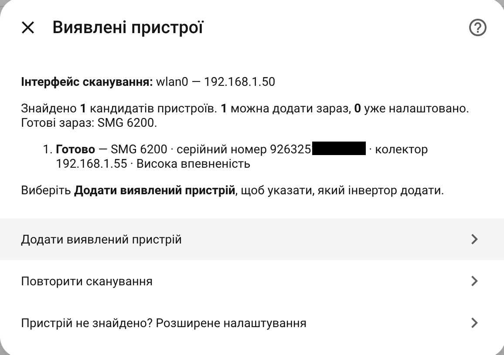

# Підключення інвертора до Home Assistant

[English](GETTING_STARTED.md)

[Встановіть EyeBond Local](INSTALLATION.uk.md), підключіть колектор до Wi-Fi
та не змінюйте кабель або налаштування інвертора для першої перевірки.

## Знайдіть і додайте колектор

1. Відкрийте **Налаштування → Пристрої та служби → Додати інтеграцію → EyeBond Local**.
2. Оберіть інтерфейс HA, який має доступ до колектора, й почніть сканування.
3. Оберіть визначений колектор. Якщо потрібне підтвердження адреси, виконайте
   цей крок замість створення нових паралельних спроб налаштування.
4. Додайте колектор і дочекайтеся визначення інвертора.

Колектор та інвертор зазвичай стають окремими пристроями HA. Онлайн-стан
колектора ще не доводить підтримку протоколу інвертора. Зачекайте завершення
визначення та перевірте його стан перед зміною драйвера.

## Якщо пошук нічого не знайшов

Перевірте обраний інтерфейс і Wi-Fi колектора. Для іншої маршрутизованої
підмережі додайте відомі IP до сканування або скористайтеся ручним режимом:
broadcast зазвичай не проходить через маршрутизатор. Advertised-адреса
зворотного підключення має бути доступна **з боку колектора**, а не лише браузера.

UDP discovery зазвичай використовує порт 58899, після чого колектор відкриває
TCP-з'єднання до слухача HA, зазвичай 8899. Відповідь UDP ще не доводить
працездатність TCP-шляху або ідентифікації. Не відкривайте порти в Інтернет
заради локального пошуку; для віддаленого доступу за можливості використовуйте VPN.

Докладні англомовні довідники: [пошук](SETUP_AND_DISCOVERY.md), [мережі / NAT](REMOTE_SETUP.md).

## Спочатку перевірте показання

Порівняйте напругу батареї, PV та навантаження з дисплеєм інвертора. Спочатку
залиште автоматичне опитування. Застарілі або недоступні дані потребують
діагностики, а не зменшення інтервалу.

У ручному режимі три поспіль успішні цикли, що тривають не менше заданого
інтервалу, тимчасово додають паузу за фактичним часом відповіді. Налаштування
користувача не змінюється; після трьох швидших успішних циклів звичайний інтервал
повертається. Для G-ASCII поточні показники зчитуються кожного циклу, а налаштування
після першого повного знімка — періодично, до чотирьох груп за цикл. Зміни через
хмару або екран інвертора продовжують оновлюватися в HA; локальний запис має
негайне пріоритетне зчитування для підтвердження. 60 секунд — строк постановки
групи в чергу, а не гарантований час оновлення за будь-якого стану зв’язку.

- **Лише читання:** локальний запис вимкнений.
- **Авто:** підтверджені контроли за достатньо впевненого визначення.
- **Повне керування:** доступні, зокрема неперевірені, контроли. Це не гарантія
  підтримки й не привід експериментувати з невідомими електричними параметрами.

Змінюйте лише зрозумілі значення та перевіряйте їх повторне читання.
Відсутні налаштування іноді можна додати через [навчання](LEARNING.uk.md).
На справній інсталяції не потрібно вмикати всі сутності або обов'язково навчати пристрій.

## Свідомо оберіть режим з'єднання

**Хмара + Home Assistant** зберігає сервер виробника та додає локальне
з'єднання для сумісних колекторів. **Лише Home Assistant** явно змінює endpoint
і вимикає хмару виробника. Перед перемиканням перевірте можливість відновлення.
Cloud Bridge — окрема розробка 0.4, а не інша назва цього режиму.

Звичайному локальному моніторингу пароль хмари не потрібен. Необов'язкові
аналіз і навчання запитують облікові дані окремо.
[Керування колектором — англійською](COLLECTOR_MANAGEMENT.md).

## Далі

- [Усунення проблем](TROUBLESHOOTING.uk.md)
- [Сенсори й керування — англійською](RUNTIME_AND_INVERTER.md)
- [Додаткова картка панелі](https://github.com/groove-max/ha-eybond-local-card)
- [Як отримати допомогу](HELP.uk.md)
